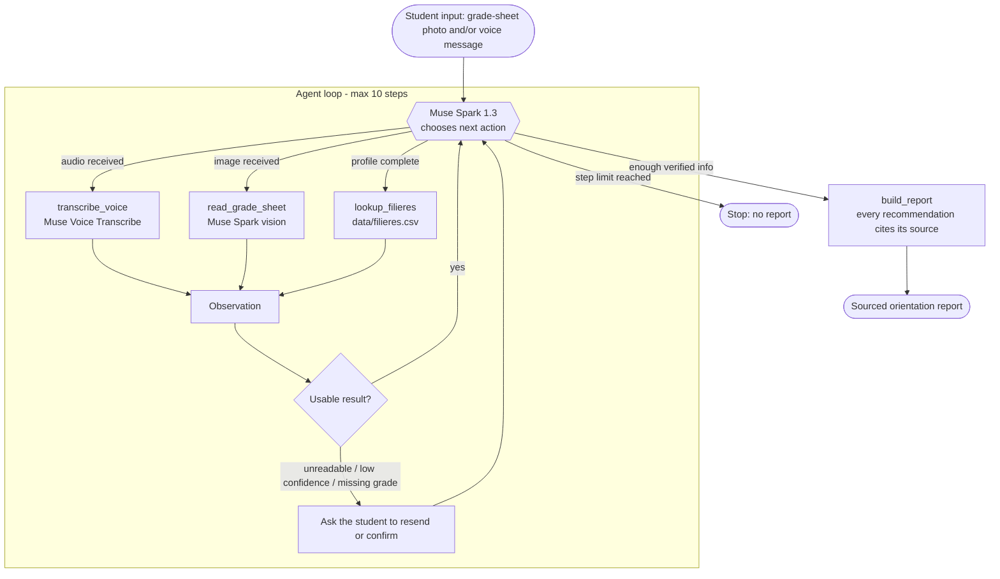

# OrientBot Agent (Meta Hackathon)

An agent that takes a post-BAC student's grade-sheet photo and voice message, chooses its own tools step by step, and produces a sourced orientation report for Benin.

> **Status: early scaffold (build period 26 Oct - 3 Nov 2026).** The agent loop is a skeleton; `read_grade_sheet` and `transcribe_voice` are not implemented yet. The only tested part is a small tool-calling check (see below).

## Problem

- TODO: sourced figures on post-BAC orientation in Benin (see `docs/impact.md`). No number is stated until a source is added.

## What is new in this repository

OrientBot already exists as a separate project. **No code from it is copied here.** Everything in this repository was written during the hackathon:

- the agentic loop (tool selection, execution, observation, next decision),
- the tools in `src/tools/`,
- the Meta API client,
- the evaluation cases in `evals/`,
- the demo web page and API stub (`web/`, `src/api/`),
- the sourced programs dataset (`data/filieres.csv`, currently empty/TODO).

Only business *rules* are re-specified from the earlier project (MESRS coefficient table to be re-typed by hand from the official source, subject-name normalization, "nothing without a source", "ask rather than guess"). No file or code is copied, and the earlier project's guides are not republished. See `docs/v1-reuse.md`.

Project documents: `docs/prd.md` (scope, requirements, 9-day plan), `docs/architecture.md`, `docs/impact.md`, `docs/demo-script.md`.

Out of scope for this event: WhatsApp, payment, landing page, database, text-to-speech, parents' report, scholarship calculation, full RIASEC questionnaire.

## Demo

Video: TODO

## How the agent decides



Design intent (the loop is a skeleton and has not been run end to end yet).

Tools:

| Tool | Purpose | State |
|---|---|---|
| `transcribe_voice` | Transcribe a voice message | not implemented |
| `read_grade_sheet` | Read grades from a sheet photo | not implemented |
| `lookup_filieres` | Look up programs in `data/filieres.csv` (only `source_status = verifie` rows) | implemented, dataset TODO |
| `build_report` | Report where each recommendation cites its source | skeleton |

If an input is unreadable or a grade is missing, the agent is designed to ask rather than guess (not yet evaluated).

## Meta models used

| Task | Model | Role |
|---|---|---|
| Reasoning, tool choice, text | Muse Spark 1.3 | Agent brain |
| Grade-sheet reading | Muse Spark 1.3 (vision) | Extract grades from photos |
| Voice message transcription | Muse Voice Transcribe | Speech to text |

Tool calling in Muse Spark 1.3 was observed working in a small test (1 tool, 5/5 runs, see `docs/muse-spark-tool-call-results.md`); multi-tool choice and vision are not tested yet. There is no text-to-speech.

## Quick start

```bash
pip install -r requirements.txt
cp .env.example .env   # then set MUSE_API_KEY
python -m src.main     # currently exits: not implemented
uvicorn src.api.server:app --reload --port 8000   # demo UI at http://127.0.0.1:8000/
```

Tool-calling check (Muse Spark 1.3): `python scripts/test_muse_tool_call.py` — see `docs/muse-spark-tool-call-results.md`.

## Evaluation

Five cases in `evals/cases.jsonl`: blurry photo, missing grade, noisy voice message, clear sheet (series C), no matching program. Target: 4 of 5 compliant and zero invented grades or programs. Sample files are not created yet. Results (to be committed in `evals/results/`): TODO (nothing measured).

## Limitations

- Agent is not functional end to end yet.
- Tool calling was only checked on one tool and one question (5/5 runs); multi-tool choice and vision are untested.
- `data/filieres.csv` has no verified entries yet, so no recommendation can be produced. The target is about 15 verified programs for series C and D, to illustrate the loop. It will not be a national database.
- Only fictional sample data; no real-student testing.
- No voice output.
- Handwritten grade sheets will likely be unreliable; the first tests use printed fictional sheets.

## Team

TODO: list all teammates.

## License

MIT, see `LICENSE`.
