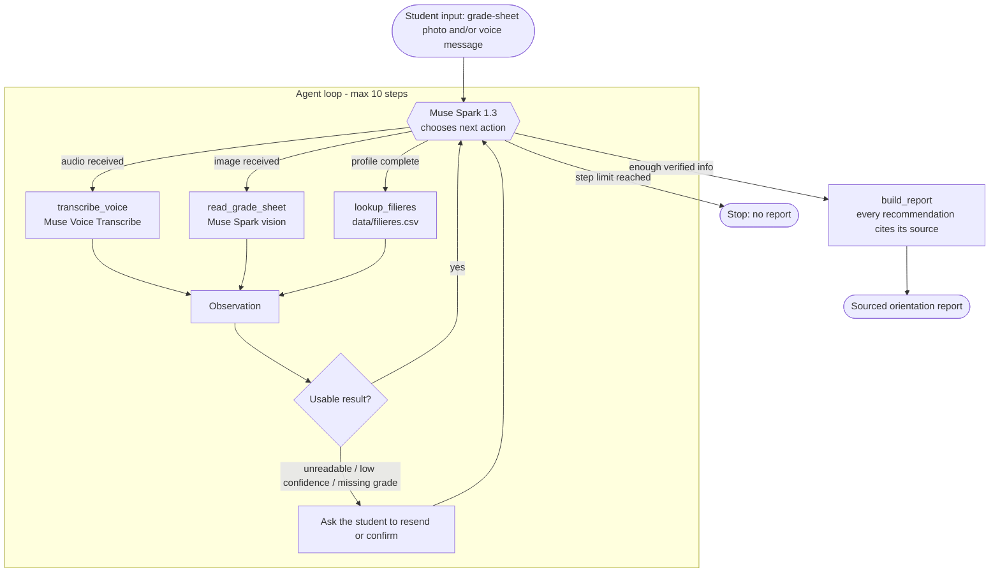

# Architecture

## Boucle de l'agent

Limite de pas : 10 (`MAX_STEPS`). Si une entrée est illisible ou une note manque, l'agent demande à l'élève au lieu de deviner.

## Outils

| Outil | Rôle | État |
|---|---|---|
| `transcribe_voice` | Transcription (Muse Voice Transcribe) | non implémenté |
| `read_grade_sheet` | Lecture d'un relevé (Muse Spark, vision) | non implémenté |
| `lookup_filieres` | Lecture de `data/filieres.csv` (lignes non vérifiées exclues) | implémenté (données TODO) |
| `build_report` | Rapport citant ses sources | implémenté (squelette) |

## Décisions

- Python, SDK OpenAI pointé sur `https://api.meta.ai/v1`.
- Pas de synthèse vocale (l'API Meta n'en propose pas).
- Aucune recommandation sans ligne sourcée dans `data/filieres.csv`.
- Aucune donnée réelle d'élève ; relevés fictifs uniquement.

## Points à confirmer

- **Appel d'outils (function calling) de Muse Spark 1.3 : NON VÉRIFIÉ.** https://dev.meta.ai/docs/models n'était pas accessible depuis l'environnement de création (erreur DNS). `src/agent/loop.py` suppose le format OpenAI `tools`/`tool_calls` ; à confirmer. Plan B si non supporté : sortie JSON structurée et dispatch manuel.
- Identifiants exacts des modèles (Muse Spark 1.3, Muse Voice Transcribe) et format d'envoi des images/audio : à confirmer.
