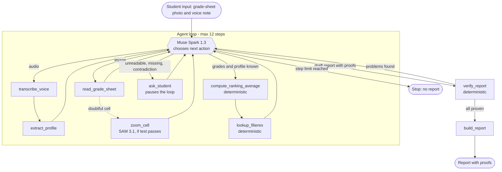

# Architecture

Document de conception de PathProof. Le comportement attendu est dans `docs/prd.md` ; ici, la structure technique. **Rien de ceci n'est encore implémenté de bout en bout** (voir la colonne « État »).

## Boucle de l'agent

Limite de pas : 12 (`MAX_STEPS`, encore à 10 dans `src/agent/loop.py`, à aligner). `ask_student` suspend la boucle jusqu'à la réponse de l'élève.

## Outils

| Outil | Rôle | Moteur | État |
|---|---|---|---|
| `transcribe_voice` | Transcrire la note vocale | Muse Voice Transcribe | non implémenté |
| `extract_profile` | Série, moyenne déclarée, intérêts, métier, contraintes, avec citation exacte | Muse Spark 1.3 (JSON strict) | non implémenté |
| `read_grade_sheet` | Lire le relevé en `[{matiere, note, lisible}]` | Muse Spark 1.3 (vision) | non implémenté |
| `zoom_cell` | Isoler une cellule douteuse et la relire | SAM 3.1 + Muse Spark 1.3 | conditionnel au test du J1 |
| `compute_ranking_average` | Moyenne de classement d'une offre (formule page 8) | code | non implémenté (données prêtes) |
| `lookup_filieres` | Filtrer les offres accessibles puis les classer | code | stub sur l'ancien schéma `filieres.csv`, à réécrire |
| `ask_student` | Poser une question, suspendre la boucle | interface | non implémenté |
| `verify_report` | Contrôler chaque preuve du brouillon | code | non implémenté |
| `build_report` | Mettre en forme le rapport validé | code | squelette |

## Preuves et vérificateur

Le rapport est d'abord un JSON où chaque affirmation porte une preuve de type `grade`, `transcript`, `filiere` ou `calc`, avec sa référence :

- `grade` : une note lue sur la photo (matière, valeur) ;
- `transcript` : une citation, qui doit exister mot pour mot dans la transcription ;
- `filiere` : un `Offre_ID` d'une ligne `Statut_qualité = OK` et sa page du PDF (`data/pages_offres.csv`) ;
- `calc` : un résultat de `compute_ranking_average` avec la formule et la provenance de chaque coefficient.

`verify_report` est du **code**, pas un second appel au modèle : il contrôle que chaque référence existe et correspond. Tant qu'il renvoie un problème, aucun rapport n'est affiché (FR-8). Le format JSON des preuves est figé au J3.

## Données

| Fichier | Rôle |
|---|---|
| `data/offres_publiques_2026_2027.csv` | 224 offres ; source principale de `lookup_filieres` |
| `data/series_et_offres_2026_2027.csv` | 897 couples série–offre ; index par série |
| `data/controle_qualite_2026_2027.csv` | 39 anomalies ; section « Ce que je n'ai pas pu vérifier » |
| `data/pages_offres.csv` | offre → page du PDF officiel (brouillon : 19 à vérifier, 2 introuvables) |
| `data/coefficients_bac_benin.json` | coefficients du Bac par série (groupe 1) ; entrée de `compute_ranking_average` |
| `data/filieres.csv` | ancien gabarit vide, remplacé par les fichiers ci-dessus ; à supprimer avec la réécriture de `lookup_filieres` |

Le PDF du guide n'est pas versionné (`data/source/`, ignoré par git).

## Décisions

- Python, SDK OpenAI pointé sur `https://api.meta.ai/v1`.
- Pas de synthèse vocale (l'API Meta n'en propose pas).
- Accès strict (lignes `OK`, série dans `Bac_recommandé`, mode d'entrée affiché), classement expliqué. Détail : `docs/prd.md` section 3.
- Le modèle ne calcule jamais une moyenne ni un filtre : ce sont des outils déterministes.
- Aucune donnée réelle d'élève ; relevés et notes vocales fictifs uniquement.
- `MUSE_API_KEY` côté serveur uniquement, dans `.env`.

## Points à confirmer

- **Appel d'outils (function calling) de Muse Spark 1.3 : observé, non documenté.** `scripts/test_muse_tool_call.py` (rapport : `docs/muse-spark-tool-call-results.md`) montre 5 réussites sur 5 avec un seul outil `lookup_filieres` et une seule question. Ni le choix entre plusieurs outils, ni les appels enchaînés, ni la vision ne sont testés. Résultats rapportés, non rejoués par nous.
- Identifiant et format d'envoi de **Muse Voice Transcribe** (audio, français), et format d'envoi des images : à confirmer dans la documentation officielle (J1).
- **SAM 3.1** : localise-t-il une cellule de tableau avec un prompt texte ? Décision go / no go sur `zoom_cell` au J1.
